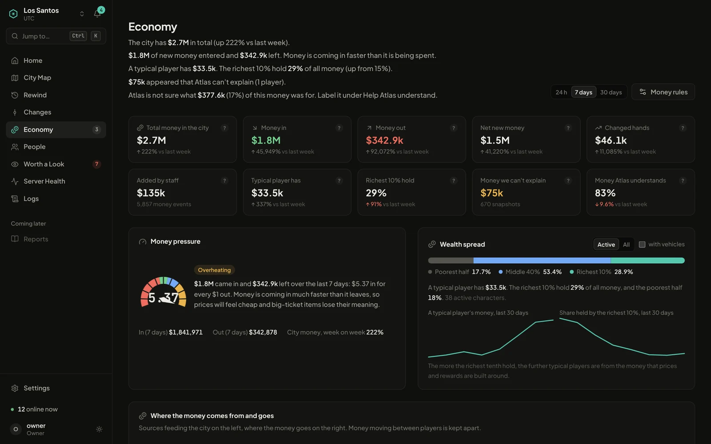
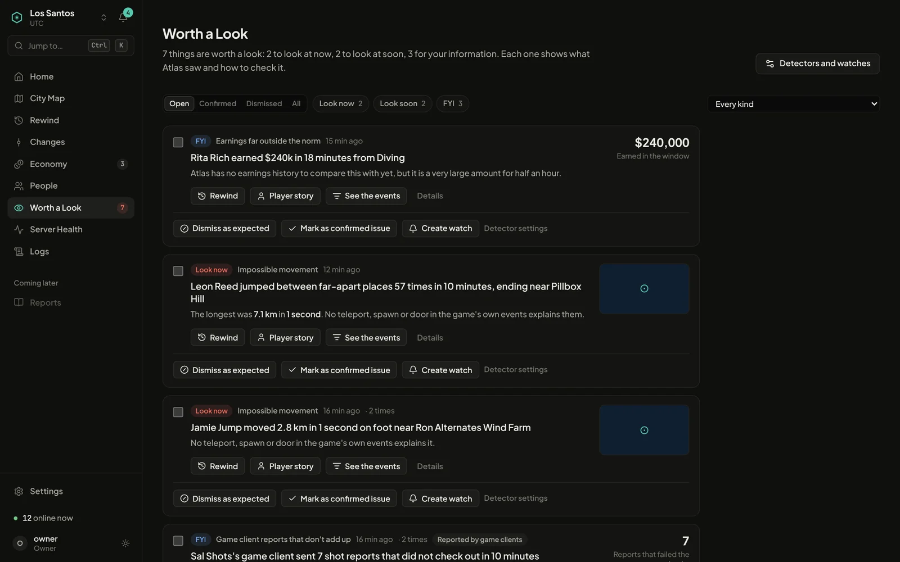

<div align="center">


[](https://osmfxmods.com/atlas)
[](https://atlas.osmfxmods.com)
[](https://www.osmfxmods.com/discord)

[](https://github.com/OsmFX-Mods/atlas-agent/releases/latest)

</div>

**Your logs tell you what happened. Atlas tells you what it means.**

[Atlas](https://osmfxmods.com/atlas) is analytics for FiveM servers: every player, every dollar and every moment in your city on one live map, explained in plain words. No dashboards to build and no queries to write.

This repository is the **Atlas agent**, the small resource you install on your game server. It watches what happens in your city and sends it to your Atlas dashboard. The heavy lifting runs on the Atlas side, so the agent stays light.

> **Early access.** Atlas is free and open by invitation, for Qbox and ESX servers with 5 to 25 players. The agent needs a token from an Atlas dashboard to do anything, so [request access on the Atlas page](https://osmfxmods.com/atlas) first.

---

## What Atlas does with it

<table>
<tr>
<td width="50%"></td>
<td width="50%"></td>
</tr>
<tr>
<td align="center"><sub><b>Economy</b>: where money enters, leaves and ends up</sub></td>
<td align="center"><sub><b>Worth a Look</b>: the unusual things first, each with its evidence</sub></td>
</tr>
</table>

<sub>Screens show demo data from Atlas's built-in simulator, not a real city.</sub>

<!-- TODO: add real City Map and Rewind screenshots (docs/media/showcase-map.webp, showcase-rewind.webp) -->

| | |
| :--- | :--- |
| **City Map** | Where people hang out, drive, fight and spend money, on a live map. Filter by hour, day, job or a single player. |
| **Rewind** | Pick a place and a minute, and replay what happened: positions, shots and deaths on a timeline. A 30-minute log dig becomes a 30-second replay. |
| **City Economy** | Where money enters your city, where it leaves, and how much ends up with your richest players. |
| **Worth a Look** | Atlas reads what your players did and puts the unusual things first, each one a click from its evidence. |
| **Changes and Impact** | Shipped a resource update? Atlas lines up the week before and after and tells you whether the shift is likely your change. |
| **Server Health** | Smoothness, memory and script errors grouped by resource. |

See it in action on the [Atlas page](https://osmfxmods.com/atlas).

---

## What the agent collects

The agent only reads facts that already exist on your server.

| Area | What is captured |
| :--- | :--- |
| **Movement** | Player positions, sampled every 3 seconds (every second near a fight). A player who stands still is reported with a still marker every 30 seconds instead of a stream of identical positions. |
| **Combat** | Damage, deaths and explosions. Shots fired are reported by the client in aggregate and checked by the server. |
| **Money** | Every cash and bank change with its reason, plus a snapshot of balances every 15 minutes. |
| **Items** | Moves, uses, purchases and crafting from `ox_inventory`, plus a daily census of items. |
| **Vehicles and medical** | Ownership and transfers from `qbx_vehicles`, vehicle ownership from the database, check-ins and revives from `qbx_medical`, and deaths and revives from `esx_death` (or `esx_ambulancejob` on older ESX). |
| **Sessions** | Joins, leaves, character changes, job and gang changes, resource restarts. |
| **Chat** | Message length and command name only. Message text is off unless you turn it on. |
| **Logs** | Log lines from `ox_lib`'s logger when it is pointed at Atlas (see [Logs](#logs)), plus script errors and warnings from the server console. |

**Privacy.** Player names and the identifiers `license`, `license2`, `discord`, `fivem`, `steam`, `xbl` and `live` are sent so Atlas can tell players apart. IP addresses are never sent.

**Your token stays secret.** The token is read only by the transport script and is never replicated to players. If it is set the wrong way (`setr` or `sets`, in a cfg file or on the command line), the agent refuses to run and tells you why.

---

## Install

### Requirements

- A FiveM server with **OneSync** enabled
- An Atlas dashboard, and a server token from it ([request access](https://osmfxmods.com/atlas))
- A framework: [Qbox](https://github.com/Qbox-project) (`qbx_core`) or [ESX Legacy](https://github.com/esx-framework/esx_core) (`es_extended`). Optionally [`ox_inventory`](https://github.com/overextended/ox_inventory) for items; ESX also works with its built-in inventory. Without a framework the agent still sends sessions, positions and combat, and uses the player account as the character.
- [`oxmysql`](https://github.com/overextended/oxmysql) for the money, item and vehicle snapshots. Optional.
- [`qbx_vehicles`](https://github.com/Qbox-project/qbx_vehicles), [`qbx_medical`](https://github.com/Qbox-project/qbx_medical) and [`Renewed-Banking`](https://github.com/Renewed-Scripts/Renewed-Banking) add vehicles, medical and bank accounts when present.

Resources can start in any order. The agent attaches to each one as it starts. If both Qbox and ESX are installed, the first to start is used; see [Frameworks](docs/frameworks.md) to choose.

### Steps

1. Download `atlas-agent-vX.Y.Z.zip` from the [latest release](https://github.com/OsmFX-Mods/atlas-agent/releases/latest).
2. Extract the `atlas-agent` folder into your server's `resources` directory.
3. Open the dashboard at [atlas.osmfxmods.com](https://atlas.osmfxmods.com), add your server, and copy the lines it shows you into `server.cfg`. They look like this:

   ```cfg
   set atlas:endpoint "https://your-atlas-address"   # shown in the Atlas dashboard
   set atlas:token    "atl_live_..."                 # created in the Atlas dashboard; keep it secret
   ensure atlas-agent
   ```

4. Restart the server. Your city appears on the map as people play.

Use `set`, never `setr`. A `setr` convar is replicated to every connected player, so the token would leak.

> **Resource name.** The resource is called `atlas-agent`, so use `ensure atlas-agent`. If your dashboard still shows `ensure atlas` in its setup lines, change it to match the folder. The agent does not depend on its own name, so a renamed folder works too as long as `server.cfg` uses the same name. The manifest also provides the name `atlas`, so scripts that call `exports.atlas:track(...)` can keep working; new code should call `exports['atlas-agent']:track(...)`.

### Check that it works

Run these in the server console:

```
atlas_selftest      # checks the token, the connection to Atlas, adapters, database and clock
atlas_bench         # shows what the agent costs on your server
```

Both are restricted to the console, or to ACE `command.atlas_selftest` and `command.atlas_bench`. The selftest lists which framework and adapters are attached, and why any were skipped.

---

## Logs

Atlas shows log text on its Logs page. The agent gets it there two ways.

### 1. ox_lib straight to Atlas

`ox_lib` sends its logs to one place only. If no other log service uses it, point its Loki logger at Atlas. Every script that calls `lib.logger` (including `qbx_core` and `ox_inventory`) then logs to Atlas.

```cfg
set ox:logger "loki"
set loki:endpoint "https://your-atlas-address"   # same value as atlas:endpoint
set loki:user "atlas"
set loki:password "atl_live_..."                 # same value as atlas:token
```

If you already send `ox_lib` logs to Fivemanage, Datadog or Grafana Loki, keep that. Atlas does not share the stream, so script log lines will not appear in Atlas; everything else the agent sends still does.

### 2. Console capture

Script errors and warnings are printed to the server console and written to `fxserver.log`, which Atlas cannot read. The agent listens to the console and sends lines that contain `SCRIPT ERROR`, `error`, `failed`, `warning` or `hitch` in any letter case, plus the stack lines that follow a script error. It is on by default; set `atlas:console 0` to turn it off. The words, the line limit and the line length can be changed in `config.lua`.

### Limits

- Console capture relies on the `RegisterConsoleListener` native, which has not been confirmed on every server build. The heartbeat reports `logs.console` as `on`, `unsupported` (the native is missing) or `off`, so Atlas shows whether it is active.
- The agent does not read `fxserver.log` and does not collect logs from scripts that do not use `lib.logger` or print to the console.

---

## Configuration

Everything has a sensible default. The common settings are convars: add them to `server.cfg` with `set`. Everything else is in [`config.lua`](config.lua).

| Convar | Default | What it does |
| :--- | :--- | :--- |
| `atlas:endpoint` | `http://127.0.0.1:7271` | Where Atlas listens. Copy the value from your dashboard. |
| `atlas:token` | none | Your server token. Required. |
| `atlas:sample_ms` | `3000` | How often each player position is sampled (minimum 500). |
| `atlas:combat_boost` | `1` | Sample more often near a fight. |
| `atlas:client_combat` | `1` | Count shots fired on the client and report them in aggregate. |
| `atlas:chat_content` | `0` | Send chat text. Off means length and command name only. |
| `atlas:framework` | `auto` | Which framework to read: `auto`, `qbox`, `esx` or `none`. See [Frameworks](docs/frameworks.md). |
| `atlas:snapshots` | `1` | Money, account and item snapshots from the database (needs `oxmysql`). |
| `atlas:census_hour` | `5` | Hour of day (server time) for the daily item and vehicle census. |
| `atlas:place_visits` | `1` | Record shop and stash visits as places. |
| `atlas:ox_createitem` | `0` | Record every `ox_inventory` item creation. Noisy, so off by default. |
| `atlas:census_full_weekday` | `0` | Weekday of the full item census, 0 for Sunday. Other days send changes only. |
| `atlas:spool_mb` | `200` | Disk space for events kept while Atlas is unreachable. |
| `atlas:console` | `1` | Capture script errors and warnings from the server console. |
| `atlas:debug` | `0` | Verbose console output. |

If Atlas cannot be reached, events are kept on disk and sent in order once the connection is back.

### More settings in `config.lua`

| Setting | Default | What it does |
| :--- | :--- | :--- |
| `boostRadius` | `150.0` | Metres around a fight where players are sampled more often. |
| `boostMs` | `60000` | How long the faster sampling lasts. |
| `boostSampleMs` | `1000` | Time between samples during a fight. |
| `moveMeters` | `1.0` | Distance a player must move to count as moved. |
| `turnDegrees` | `20` | Turn a player must make to count as moved. |
| `stillEveryMs` | `30000` | How often a player who stands still is reported. |
| `damageRatePerSec` | `100` | Most damage events accepted from one player per second. |
| `explosionRatePerSec` | `20` | Most explosion events accepted from one player per second. |
| `killWindowMs` | `10000` | How long after a hit it still counts as the cause of a death. |
| `moneyEveryMin` | `15` | Minutes between money snapshots. |
| `accountsEveryMin` | `15` | Minutes between bank account snapshots. |
| `moneyFullEveryDays` | `7` | Days between full money snapshots. Other runs send changes only. |
| `moneyFullEveryMin` | `60` | Minutes between full money snapshots on a framework that cannot list changed rows. |
| `censusFullMaxDays` | `8` | A full item census also runs when the last one is older than this. |
| `placeRadius` | per kind | Size in metres of each kind of place: `shop`, `garage`, `hospital`, `police`, `bank` and `custom`. |
| `qbox.tables` | `players`, `player_vehicles`, `properties` | Qbox table names, for servers that renamed them. |
| `esx.tables` | `users`, `owned_vehicles`, `vehicles`, `items`, `addon_account_data` | ESX table names, for servers that renamed them. |
| `esx.accounts` | `money` as cash, `bank` as bank, `black_money` as its own type | Money type per ESX account. Cash, bank and crypto are included in money snapshots; any other name is reported in money changes only. Accounts left out are not tracked. |
| `esx.deathSettleMs` | `500` | Older ESX: how long to wait after the dead state changes for the matching client event. |
| `esx.deathSignalMs` | `5000` | Older ESX: how recent a client death or respawn event must be to count. |
| `esx.changedColumn` | `last_seen` | `users` column that updates when a row changes, used to read only changed rows. |
| `consoleWords` | `error`, `failed`, `warning`, `hitch` | Words that make a console line worth sending, in any letter case. |
| `consoleMaxLines` | `100` | Most console lines sent per second. |
| `consoleMaxChars` | `1000` | Console lines are cut to this length. |
| `consoleStackMs` | `2000` | How long the lines after a script error are kept. |
| `flushMs` | `250` | How often queued events are handed to the sender. |
| `heartbeatMs` | `10000` | How often the agent reports that it is alive. |

These are plain values, so changes are lost when you replace the files. Keep your edits when updating.

---

## Other frameworks

A server with its own framework can report characters, jobs and gangs through exports, and a new framework adapter is two small files. [`docs/frameworks.md`](docs/frameworks.md) has the details.

---

## Updating

Download the new release, replace the files in the `atlas-agent` folder and restart the resource. Keep the `spool` folder if it exists: it holds events that are still waiting to be sent. If you edited `config.lua`, copy your changes into the new file. Release notes are on the [Releases](https://github.com/OsmFX-Mods/atlas-agent/releases) page.

## Development

The agent is Lua (server and client) plus one Node script for the network transport. The tests need Node.js and a Lua 5.4 binary:

```
node tests/transport.test.js    # transport: real local HTTP server, spool, retries, token scan
lua5.4 tests/run.lua            # pure modules, plus server scripts run against a FiveM stub (tests/fivem.lua)
```

Releases are built by GitHub Actions. To publish one, run the **Release** workflow from the Actions tab and enter a version (for example `0.2.0`), or push a tag such as `v0.2.0`. The workflow runs the tests, stamps the version into `fxmanifest.lua`, and attaches `atlas-agent-v0.2.0.zip` (containing a single `atlas-agent` folder) and its SHA-256 checksum to a GitHub release.

## Links

- [Atlas](https://osmfxmods.com/atlas): what it is and how to get access
- [Atlas dashboard](https://atlas.osmfxmods.com): sign in or add a server
- [OsmFX Mods](https://osmfxmods.com): all our resources
- [Discord](https://www.osmfxmods.com/discord): support and updates
- [Releases](https://github.com/OsmFX-Mods/atlas-agent/releases): downloads and release notes

---

<div align="center">
<sub>Built by <a href="https://osmfxmods.com">OsmFX Mods</a>. Every line of Atlas, including this agent, is written by AI agents.</sub>
</div>
